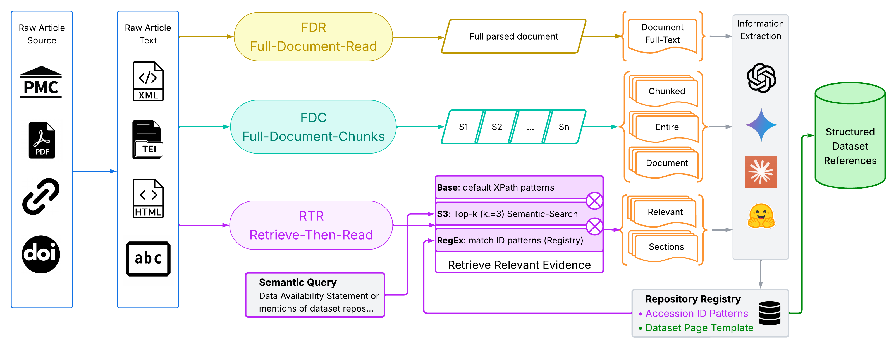

.. image:: https://readthedocs.org/projects/data-gatherer/badge/?version=latest
   :target: https://data-gatherer.readthedocs.io/en/latest/
   :alt: Documentation Status

Data Gatherer
=============

**Data Gatherer** is a Python library for automatically extracting dataset references from scientific publications.
It processes full-text articles—whether in HTML or XML format—and uses both rule-based and LLM-based methods
to identify and structure dataset citations.

What It Does
------------

- Parses scientific articles from open-access sources like PubMed Central (PMC).
- Extracts dataset mentions from structured sections (e.g., Data Availability, Supplementary Material).
- Supports three strategies:

  - **Full-Document Read (FDR)**: Applies a large-context LLM to the full parsed document.
  - **Full-Document Chunks (FDC)**: Splits the full document into chunks that fit the model's context and reads
    each of them, for small models such as the fine-tuned Flan-T5.
  - **Retrieve-Then-Read (RTR)**: First retrieves the relevant sections (Data Availability sections via XPath
    patterns, top-k semantic search, and accession ID patterns from the repository registry), then reads only those.

- Outputs structured dataset references; when passages are read one at a time (FDC, and RTR with small models),
  each reference also records the section it was extracted from.
- Includes support for known repositories (e.g., GEO, PRIDE, MassIVE) via a configurable repository registry
  (accession ID patterns and dataset page templates).

Supported inputs
----------------

Articles can be given as PMCIDs, DOIs, URLs or PDF files, and are parsed from whichever raw text is available:

- **XML**: JATS XML for PMC articles, from the Entrez E-utilities API.
- **HTML**: PMC and publisher web pages (DOIs are resolved through doi.org).
- **TEI**: PDFs converted to TEI XML with GROBID.
- **Plain text**: text extracted directly from PDFs, without GROBID.

Already fetched full texts can also be read from a local or S3 parquet cache (``--backup-file`` /
``--s3-backup-key`` in ``k8s/k8s_processor.py``).

Use Cases
---------

- Helping data curators and librarians identify datasets cited in publications.
- Supporting meta-analysis and secondary data discovery.
- Enabling dataset indexing and retrieval across the open-access literature.

Citation
--------

If you use Data Gatherer  in your research or project, please cite our paper:

.. code-block:: bibtex

	@inproceedings{marini_data_2025,
		title = {Data {Gatherer}: {LLM}-{Powered} {Dataset} {Reference} {Extraction} from {Scientific} {Literature}},
		url = {https://aclanthology.org/2025.sdp-1.10},
		doi = {10.18653/v1/2025.sdp-1.10},
		booktitle = {Proceedings of the {Fifth} {Workshop} on {Scholarly} {Document} {Processing} ({SDP} 2025)},
		publisher = {Association for Computational Linguistics},
		author = {Marini, Pietro and Santos, Aécio and Contaxis, Nicole and Freire, Juliana},
		year = {2025},
		pages = {114--123},
	}

